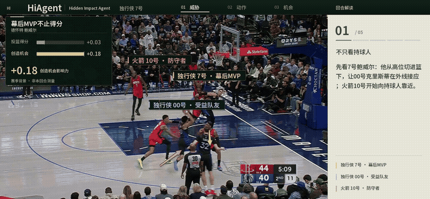

<div align="center">

# HiAgent
### Hidden Impact Agent

让篮球比赛中被忽略的贡献，回到画面里。

[快速开始](#快速开始) · [安装指南](docs/setup.md) · [AWS 部署](docs/aws.md) · [完整演示视频](examples/replay/replay.mp4)

</div>

[](examples/replay/replay.mp4)

## 它做什么

**HiAgent 从篮球视频与配套数据中寻找“幕后 MVP”**：一次掩护、接应或防守牵制，如何为队友创造出手机会。它围绕贡献者、受益队友和关键防守者组织证据，输出带角色标牌、跑位箭头、数据对比与分段解说的比赛视频。

除了成片，还可以查看关键帧故事线、出手机会对比和同场多回合汇总。独立 **Reviewer** 复核角色身份、位置与解说时序，保留原始分析及复核记录。贡献分是可解释的观察指数；预期命中率差值不直接等于某名球员造成的提升。

```text
比赛视频 + 可选配套数据
  → 球员 / 篮球 / 球场检测
  → VLM 理解配合与候选评分
  → Reviewer 复核身份、位置、分段解说
  → FFmpeg 渲染视频与故事帧
  → 回放 · 故事线 · 数据解读
```

## 快速开始

**先看效果，无需 AWS 或模型。** 安装 Python 3.13 后：

```bash
git clone https://github.com/KawhiQaQ/HiAgent.git
cd HiAgent
python3 hidden-impact/scripts/install_demo.py
python3 hidden-impact/server.py
```

打开 [本地工作台](http://127.0.0.1:8765/)，从战术回放切换到故事线、数据解读，即可浏览示例。

**分析自己的视频。** 完成[一次性环境与模型配置](docs/setup.md)后，在 `hidden-impact/` 中运行：

```bash
python scripts/analyze_video.py \
  --video /absolute/path/to/play.mp4 \
  --companion /absolute/path/to/companion.json \
  --profile hiagent \
  --out web/results/my-play
python server.py
```

打开 [分析结果](http://127.0.0.1:8765/?result=results/my-play/showcase.json)。输出目录包含 `replay.mp4`、原视频对照、故事帧、`analysis.json` 和 Reviewer 记录。没有配套数据时省略 `--companion`。

当前入口处理 **0.5–40 秒的单回合片段**。视觉计算与视频渲染在本机完成，VLM 使用你自己的 Amazon Bedrock 凭证；无需部署整套云设施，也无需微调模型。模型调用会产生费用。已有分析结果可用 `--analysis result.json` 离线重新渲染。

## 部署与开发

网页上传、异步任务和在线分享可通过[独立 AWS 部署](docs/aws.md)启用：CDK 创建 S3、Lambda、Bedrock AgentCore 与 CloudFront。账号、区域、模型、资源名称均可配置。

```bash
cd hidden-impact
python -m unittest discover -s tests
for test in tests/*.cjs; do node "$test" || exit 1; done
```

代码位于 [`hidden-impact/`](hidden-impact/)，输入示例与演示成片位于 [`examples/`](examples/)。第三方视觉权重不放进 Git，来源与安装方式见[安装指南](docs/setup.md)。请使用有权处理的视频；示例录像和第三方数据保留原权利人的权利。
